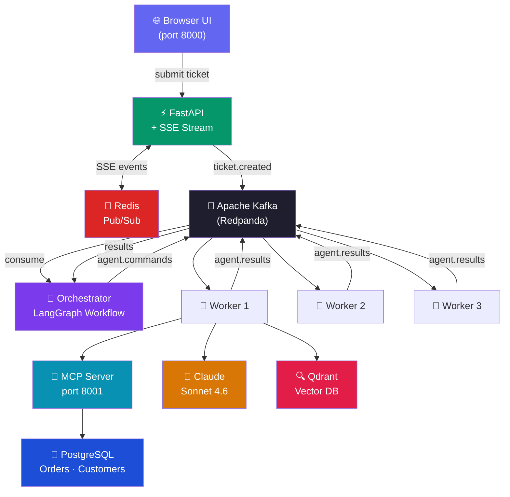
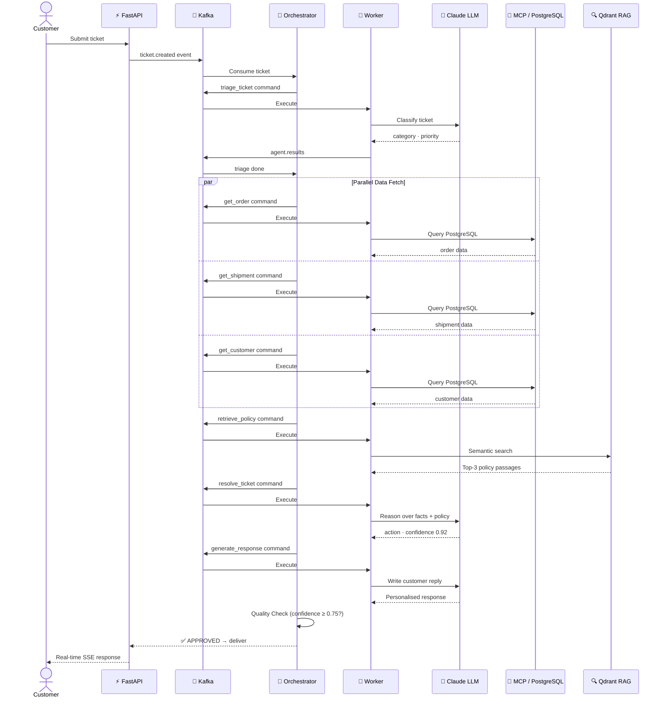
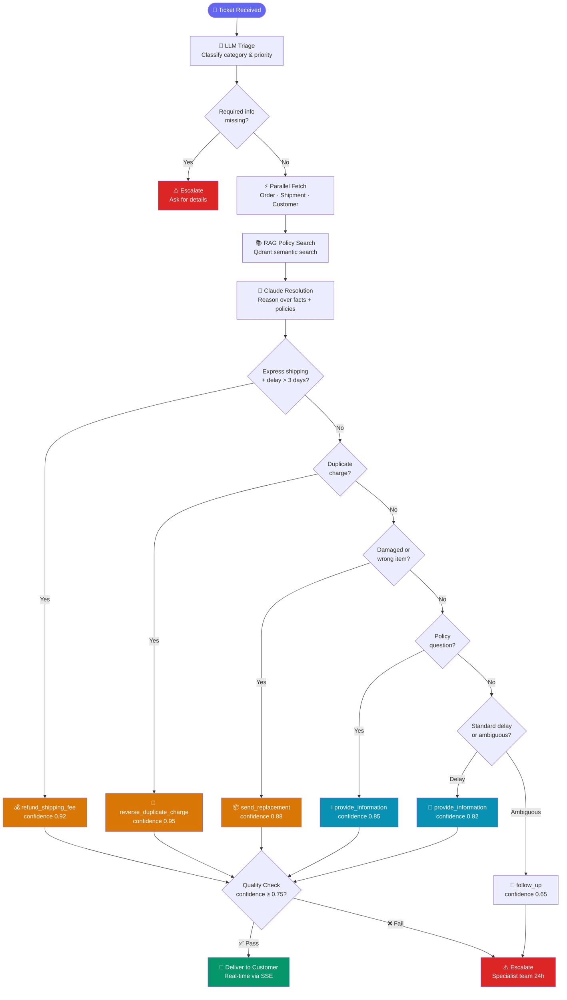
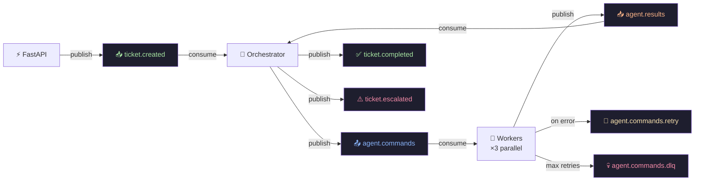

<div align="center">


<br/>

[](https://python.org)
[](https://fastapi.tiangolo.com)
[](https://redpanda.com)
[](https://langchain-ai.github.io/langgraph)
[](https://anthropic.com)

[](https://postgresql.org)
[](https://redis.io)
[](https://qdrant.tech)
[](https://docker.com)
[](LICENSE)

<br/>

> **A production-grade agentic AI platform that autonomously resolves e-commerce support tickets**
> using event-driven architecture, LLM reasoning, vector search, and real-time streaming.

<br/>

</div>

---

## 🏗️ System Architecture



---

## 🔄 Ticket Pipeline



---

## 🤖 Resolution Decision Tree



---

## 📨 Kafka Event Topology



---

## 🗂️ Project Structure

```
novasupport/
├── 🤖 agents/
│   ├── triage.py          # LLM ticket classification
│   ├── resolver.py        # LLM resolution (6 action types)
│   └── responder.py       # LLM customer reply generation
│
├── 📱 apps/
│   ├── api/               # FastAPI + SSE real-time streaming
│   ├── orchestrator/      # LangGraph multi-step workflow
│   └── worker/            # Kafka consumers + task handlers
│
├── 📚 rag/
│   ├── indexer.py         # Chunk → embed → upsert to Qdrant
│   ├── retriever.py       # Semantic search via httpx
│   └── embedder.py        # all-MiniLM-L6-v2 (384-dim)
│
├── 🔌 mcp_servers/        # MCP protocol server for PostgreSQL
├── 📡 streaming/          # Kafka schemas, producer, consumer
├── 🏗️ infrastructure/     # Docker, Kafka topics, Prometheus
├── 📊 observability/      # Logging + metrics
└── 🧪 tests/              # Unit + integration + evaluation
```

---

## ⚡ Quick Start

### 1 — Start Infrastructure

```bash
docker compose up -d redpanda postgres redis qdrant
```

### 2 — First-time Setup

```bash
python scripts/seed_database.py              # Seed PostgreSQL (20 customers, 50 orders)
python infrastructure/kafka/create_topics.py # Create 7 Kafka topics
python -m rag.indexer                        # Index 73 policy chunks into Qdrant
```

### 3 — Launch Services

```bash
# Terminal 1 — MCP Server
python -m mcp_servers.operational_data.server

# Terminal 2 — API + UI  
uvicorn apps.api.main:app --reload

# Terminal 3 — Orchestrator
python -m apps.orchestrator

# Terminal 4 — Workers
python -m apps.worker --id worker-1 --count 3
```

### 4 — Open Browser

| URL | Description |
|-----|-------------|
| `http://localhost:8000` | 🎫 Support ticket UI |
| `http://localhost:8080` | 📊 Kafka topic inspector |

---

## 🛠️ Tech Stack

| Layer | Technology | Purpose |
|-------|-----------|---------|
| 🤖 AI Reasoning | Claude Sonnet 4.6 | Triage · Resolve · Respond |
| 🧠 Orchestration | LangGraph | Stateful multi-step workflow |
| 🔍 Embeddings | all-MiniLM-L6-v2 | 384-dim policy embeddings |
| 📨 Event Bus | Kafka (Redpanda) | Decoupled agent communication |
| ⚡ API | FastAPI + SSE | Real-time browser streaming |
| 🔌 Data Protocol | MCP | Tool-based PostgreSQL access |
| 🐘 Operational DB | PostgreSQL 16 | Orders · Customers · Payments |
| 🔍 Vector DB | Qdrant 1.9 | Policy RAG (73 chunks) |
| 🔴 Cache | Redis 7 | SSE pub/sub + idempotency |
| 📊 Monitoring | Prometheus + Grafana | Metrics · Dashboards |

---

<div align="center">

Built with ❤️ using **Claude Sonnet 4.6** · **LangGraph** · **Apache Kafka** · **FastAPI** · **PostgreSQL** · **Qdrant** · **Redis**

⭐ Star this repo if you find it useful!

</div>
